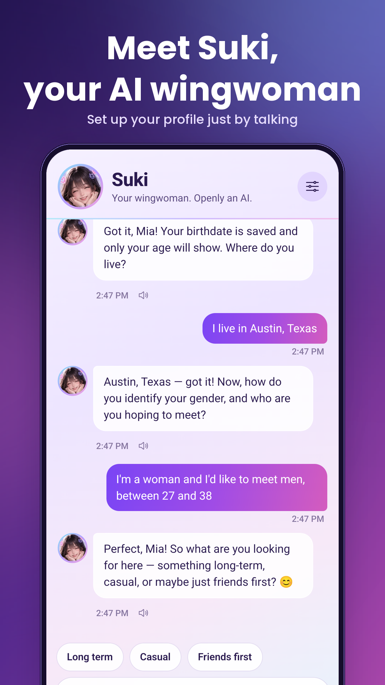
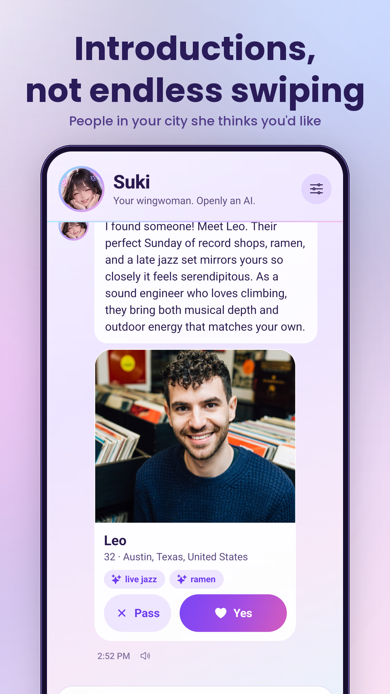
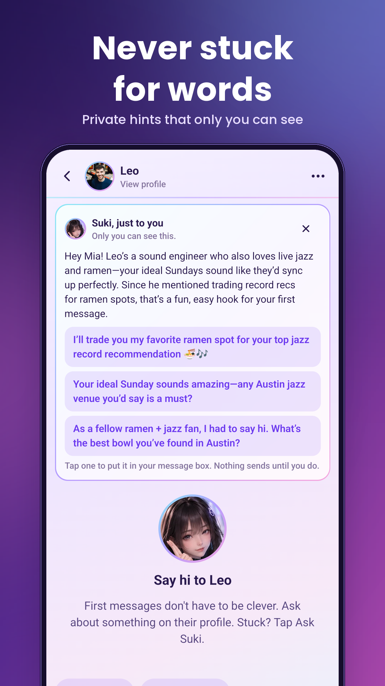
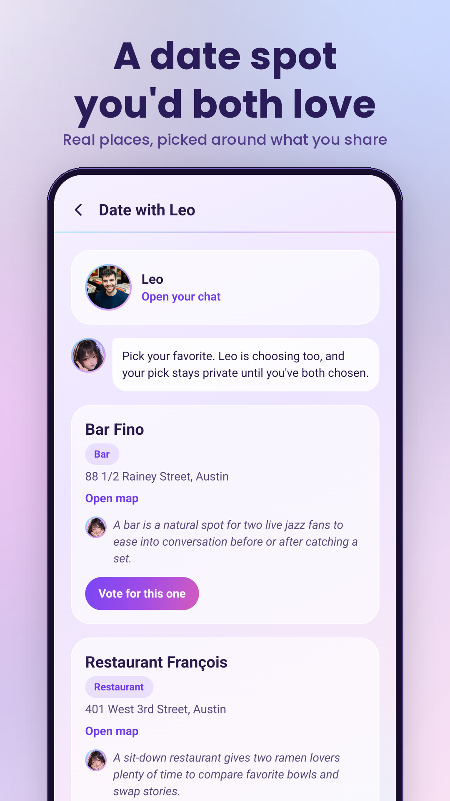
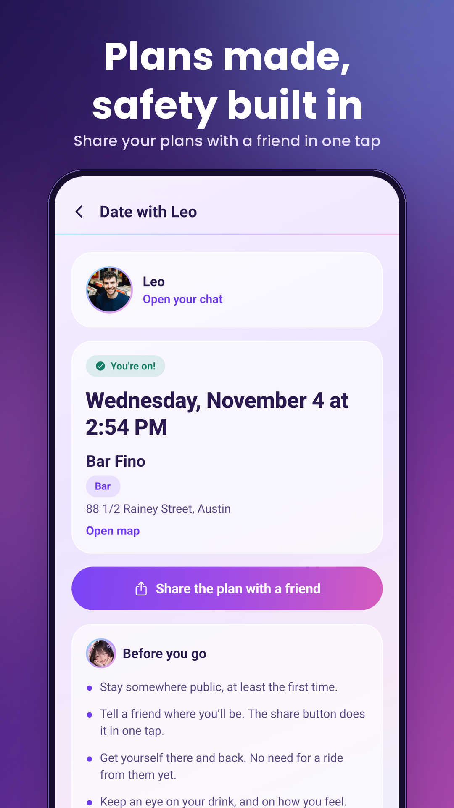
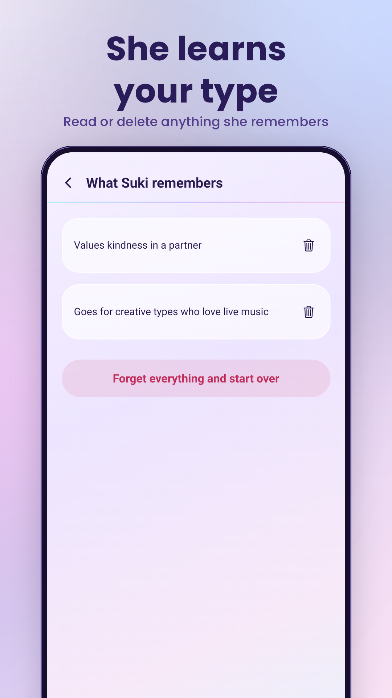

  

<h1 align="center">SynAgent</h1>

<strong>Meet Suki, a matchmaker you talk to, not a deck you swipe.</strong>

  <a href="https://match.heros-agent.space/app/">Open in your browser</a> ·
  <a href="mobile/store/demo/synagent-demo.mp4">Watch the demo</a> ·
  <a href="https://match.heros-agent.space/legal/privacy">Privacy</a> ·
  <a href="https://match.heros-agent.space/legal/terms">Terms</a>

SynAgent is an app for meeting people, on the web, iOS and Android, built around one AI
character. Tell Suki about yourself, and she introduces you to people in your city, helps the
conversation along, finds a place for the date, and gets a better sense of your type each time.
And when you just want company, for a movie tonight, a trip or a business contact, she helps you
find someone for that too.

<table>
  <tr>
    <td></td>
    <td></td>
    <td></td>
  </tr>
  <tr>
    <td></td>
    <td></td>
    <td></td>
  </tr>
</table>

## How it works

1. **Get to know Suki.** Set up your profile by talking to her: who you are, your photos, your interests, and what you're looking for.
2. **Get introduced.** Suki looks for people in your city who suit you, and explains why she thinks you'd get along. It's only a match when you both say yes.
3. **Start talking.** Chat with your match directly. Suki can suggest an opener or a question when things go quiet, and you can turn that off.
4. **Plan the date.** She shortlists public places based on what you both enjoy. You each pick a favorite privately, and the date is set once you both confirm.
5. **Tell her how it went.** What you share after a date helps her make better introductions next time.

## Company for a plan

Nobody to see a movie with tonight? Dates aren't the only reason to meet someone.

1. **Tell Suki.** A movie, a meal, a show, a trip, sports, games, business or studying, and when. She drafts a post, and a tap puts it up.
2. **People say they're in.** Suki tells members in your city, and they can join by telling her or with a tap. You can limit it to people of your gender.
3. **Pick who to go with.** Suki shows you who's in, and your posts stay on the Dates tab. Tell her who you choose, or tap, and the two of you can chat right away in Matches. For a first meet-up, pick somewhere public and tell a friend.

## Why Suki is different

- **She has a personality.** Suki has her own character, face and voice, and she answers as she thinks instead of making you wait. You can choose how she talks to you.
- **She learns your type.** Her introductions improve with what you accept, pass on and say after your dates.
- **She keeps things respectful.** Explicit photos, messages and profile text are filtered, and you can block or report anyone.
- **You stay in control.** You can read and delete what Suki remembers about you, reset what she has learned, export your data, or delete your account in Settings.

## Pricing

Your first match is free. After that, each message to Suki uses a credit, and you can buy more by asking her: by card on the web and the direct download, with Google Play in the Play version of the Android app, and with WeChat Pay in the mini program. Chatting with your matches is always free, and so is anything about your safety or your account.

**Inviting friends.** Everyone has an invite link and code (Me → Invite friends, or ask Suki). When a friend signs up with it and their profile goes live, the inviter gets 20 credits, up to 20 friends in 30 days. The mini program shares through WeChat's own share sheet.

## Also in the app

- **The same account everywhere.** Use it in your browser with nothing to install, or on your phone.
- **One-tap updates.** The Android app tells you when a new version is out and installs it from inside the app.
- **Invite friends.** Share your link or code, from the app, the web or WeChat, and earn credits when a friend joins.
- **Your language and theme.** English, Chinese, Korean, Japanese and Spanish, in light or dark.

## WeChat mini program

[`weixin/`](weixin/README.md) is a native mini program on the same server and accounts. It isn't released: that needs a registered mini program, an ICP-filed domain and WeChat's review.

## Availability

SynAgent is for adults 18 and over. [Open it in your browser](https://match.heros-agent.space/app/), or get the [direct downloads](https://match.heros-agent.space/#download). It isn't in the App Store or Google Play yet.

## Contact

[support@heros-agent.space](mailto:support@heros-agent.space)
